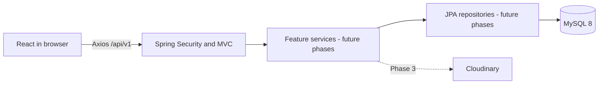

# Understanding EstateFlow

## The architecture

EstateFlow has two applications in one repository. React draws the interface in the browser. Spring Boot handles HTTP requests and will own authentication, business rules, database access, and upload authorization. MySQL stores records. Cloudinary will store image bytes in Phase 3.

The backend is a **modular monolith**: one application process and one database, organized by business feature. It has no message broker, token server, cache service, or microservices. Production should preferably put the frontend and backend behind one HTTPS origin so browser session and CSRF behavior remain straightforward.



## What exists, and what is still a design

Phase 1 has the UI, routing, API transport, status/token controllers, security configuration, entities, validation rules, and migration. It deliberately has no property API, user API, repositories, business services, or working authentication. This avoids creating empty layers or accidental data exposure before authorization exists.

When a feature is introduced, follow `Controller → Service → Repository → Database`. Controllers translate HTTP input/output. Services validate business rules and run transactions. Repositories query persistence. Entities describe stored data. Use concrete services with constructor injection; an interface for every service adds little here.

## React, routing, and server data

`main.tsx` creates one QueryClient and wraps React with QueryClientProvider, BrowserRouter, MotionConfig, and Sonner. `App.tsx` maps URL paths to pages. The home route uses the shared header/footer layout. The login route owns the entire viewport. Login and secondary preview pages are loaded with `React.lazy`, so the homepage does not need to load the full login animation at startup.

The home/property-preview search uses small component states for purpose, city, and property type. It creates a URL query string and navigates to `/properties`. That page shows the selected filters and a clear explanation that browsing is not implemented. It performs no client-side filtering over fake data. In Phase 4, read those parameters into a TanStack Query key and send validated filters and page/sort parameters to the backend.

`api/client.ts` configures Axios with `/api/v1`, credentials, and a request timeout. `useSystemStatus.ts` caches the real system status response for one minute, does not retry failures automatically, and exposes pending/error states to the UI. There is no Redux or global server-data store.

Implemented flow:

```text
Login or preview page mounts
→ useSystemStatus / TanStack Query
→ Axios GET /api/v1/system/status
→ Vite development proxy (local only)
→ Spring Security public GET rule
→ SystemController
→ SystemStatus response DTO
→ React shows a real connection state
```

The status endpoint is a capability response, not a database health probe. With normal configuration, Spring finishes startup only after connecting, migrating, and validating the database, but the status request itself does not run `SELECT 1`.

## Sessions and CSRF

A session is server-side state associated with an opaque cookie such as `JSESSIONID`. The browser sends the cookie automatically to the backend; JavaScript does not need to read it. `HttpOnly` prevents direct JavaScript access to that cookie. `Secure` must be enabled with production HTTPS. `SameSite=Lax` is configured so the future top-level Google callback can work. Sessions expire after 30 minutes of inactivity.

An anonymous session may be created now to hold a CSRF token; **that does not mean the user is authenticated**. No user identity is currently stored in it.

CSRF protects session-based mutations from requests initiated by unrelated websites. EstateFlow uses Spring Security's HttpSessionCsrfTokenRepository. The SPA fetches a token in JSON, then echoes it in `X-CSRF-TOKEN`. Only the allowed frontend origin can read the credentialed response; the token endpoint sends `no-store`. The request attribute handler uses the raw token for this JSON/header exchange.

Implemented transport flow (no business mutations are allowed yet):

```text
Axios prepares POST / PUT / PATCH / DELETE
→ GET /api/v1/auth/csrf with credentials
→ Spring materializes the deferred token in the HTTP session
→ Response DTO {headerName, token} and HTTP-only session cookie
→ Axios adds that header to the original request
→ Spring checks the header against the session token
→ Authorization still denies the unimplemented business endpoint
```

The token is fetched fresh before each mutation. That is intentionally simple and avoids caching a stale token after authentication changes. Phase 2 must retain the real sign-in/logout token lifecycle and verify it with integration tests. There are no tokens in localStorage, query parameters, or frontend authentication state.

CORS is not authorization. It only controls whether a browser origin can read cross-origin responses. Local development normally uses Vite's same-origin proxy. The backend also allows exactly `http://localhost:5173` by default, with credentials and the CSRF header. Never change that to `*` with credentials. Production should use one HTTPS origin and set the backend's exact `FRONTEND_ORIGIN`. Separate cross-site origins require a deliberate cookie and CSRF design review, not a blanket switch to `SameSite=None` or disabled CSRF.

## Google OAuth — planned for Phase 2

The login UI contains a Google button, but clicking it currently displays an explicit Phase 2 notice. It makes no OAuth request. The OAuth2 Client dependency is present; there are no client registrations or invented secrets.

The intended real flow is:

```text
Continue with Google
→ browser navigation to backend /oauth2/authorization/google
→ Spring redirects to Google with state/nonce protections
→ Google authentication and approved callback
→ Spring OAuth2/OIDC client validates the identity
→ user service finds/creates a user from the validated Google subject
→ MySQL stores Google ID, verified identity/profile, and default USER role
→ Spring creates/rotates the authenticated session
→ redirect to an allowlisted React route without credentials in the URL
→ React GET /api/v1/auth/me
→ User response DTO and appropriate UI
```

The application should associate users by the validated provider subject and handle changed emails/conflicts carefully. Agent registration must be an explicit authenticated server operation with an onboarding DTO containing profile fields only. It may grant AGENT after validation; it must never accept arbitrary roles or a client-supplied user ID. A server-side active-account check must apply to every protected operation so an already authenticated suspended account cannot keep writing.

## Entities and tables

The Java entities use Jakarta Persistence annotations and Hibernate. Each corresponds to a table created by Flyway. Hibernate's `ddl-auto=validate` checks the database; it does not create or alter it. MySQL uses `utf8mb4` for Pakistani place names and general Unicode content.

| Entity | Table | Relationship |
| --- | --- | --- |
| User | users | One Google identity; role and account status |
| AgentProfile | agent_profiles | One profile per user, unique user foreign key |
| Property | properties | Many properties belong to one agent profile |
| PropertyImage | property_images | Many images belong to one property |
| InstallmentPlan | installment_plans | At most one plan per property |

Relationship fields are lazy. Parent-side image collections are intentionally omitted for now: later repositories can fetch the exact images required, avoiding accidental giant object graphs. Database foreign keys preserve referential integrity without cascaded hard deletion of business records.

`BaseEntity` provides generated IDs and UTC timestamps for users, agents, and properties. `Instant` represents time; money uses `BigDecimal` and `DECIMAL(15,2)`. Sizes use decimal columns too. Enums use named varchar values, not fragile numeric ordinals. Java validation and database CHECK constraints both enforce basic numeric and enum rules.

`PropertyImage` records hold Cloudinary public IDs and delivery URLs, never binary image data. An indexed generated column ensures at most one cover image per property; `(property_id, display_order)` prevents duplicate image order. Installment plans require positive amounts/counts and an exact balance:

```text
totalPrice = downPayment + installmentAmount × numberOfInstallments
```

Equal fixed installments are the Phase 1 model. If a total cannot divide exactly into paise, later UI/business logic should reject it or require an explicit final-payment model/migration. Do not silently round money with double arithmetic. Java validation and MySQL enforce this balance independently.

## DTOs and controllers

An entity is an internal persistence object. Sending one directly can expose provider IDs, private addresses, internal statuses, or lazy relationships. Every API feature must define purpose-specific input/output DTOs. In Phase 1, `SystemStatus` and `CsrfResponse` are small immutable Java records; no controller returns an entity.

Future controller example:

```text
React Property Form (React Hook Form + Zod)
→ Axios request with session cookie and CSRF header
→ controller receives @Valid CreatePropertyRequest DTO
→ service reads the authenticated server-side principal
→ service checks active AGENT role and validates business rules
→ service assigns ownership from that identity
→ repository saves entity in a transaction
→ MySQL applies constraints
→ service maps to PropertyResponse DTO
→ React invalidates the appropriate TanStack Query keys
```

React Hook Form and Zod are installed for future editable forms. There is no fake email/password form or registration form in this phase. Bean Validation on entities provides persistence-level safeguards; later DTOs must add API-level validation as well.

## Private properties and ownership

Visibility, listing status, and payment status are separate concepts. `PRIVATE + SOLD + PARTIAL` is valid and covered by tests. Default visibility is PRIVATE. Archiving will set `archivedAt` rather than delete records.

At present there are **no property response endpoints**. The security chain permits only the two public infrastructure GET endpoints and denies everything else. This is the current privacy boundary, rather than a claim that future query filters are already written.

Phase 3/4 must enforce:

- Every public listing/detail/featured/related query includes `visibility = PUBLIC AND archivedAt IS NULL`. Filtering happens in the database with JPA Specifications and Pageable, including detail lookups by slug.
- Agent management queries derive the agent from the authenticated principal and scope every lookup to that agent. A request body must not control ownership.
- A service checks ownership again before update, archive, media upload, image removal, or installment changes. A guessed ID cannot grant access.
- SUPER_ADMIN access is a deliberate alternate authorization path; public routes remain public-only even for administrators.
- A public DTO excludes payment-management/internal fields, even if its source entity happens to contain them.

Indexes support public visibility/archive/city/type/purpose searches, price ranges, featured publication ordering, agent listings, location, status/payment option, size unit/size, and future full-text title/description searching. Profile and property foreign keys are indexed. Review actual query plans before adding more indexes: every index also costs write work.

## Media request flow — planned for Phase 3

```text
Agent chooses supported image files
→ frontend validates size/count for feedback
→ backend rechecks session, active account, CSRF, and property ownership
→ service verifies actual file content, MIME type, dimensions, and limits
→ server uploads to Cloudinary with server-only credentials
→ MySQL stores public ID, delivery URL, alternative text, order, and cover flag
→ public DTO returns an appropriately transformed image URL
```

The multipart limits configured now are preliminary boundaries, not an upload implementation. File signatures and safe formats must still be enforced. Do not trust filenames, client MIME types, remote upload URLs, or client-provided public IDs. Cloudinary and MySQL do not share one transaction: Phase 3 must handle upload/database failure cleanup explicitly.

The cinematic reference is unrelated to property uploads. Its rights are unverified and its URLs are replaceable. See [MEDIA.md](MEDIA.md) for sources, production replacement, and video behavior.

## Error handling and verification

Spring MVC's ProblemDetail format provides HTTP status, title, and detail. The global handler adds field-level validation errors and hides unexpected exception details from clients, while logging the server failure. Security filter failures occur before MVC and are written in the same problem format by the security configuration. Future business exceptions need explicit meaningful 400/403/404/409 mappings.

Frontend queries expose pending/error/success states; a backend outage never blocks login controls or media rendering. Toasts explain unfinished actions. Search, login, and connection behavior have focused component tests. Backend tests cover CSRF/access boundaries, exact-origin CORS, entity constraints, installment decimal balance, Flyway/schema compatibility, independent status values, and database cover/balance constraints.

Identity persistence, ownership, visibility queries, real onboarding form validation, and suspension tests will arrive with their implementations. Rate limiting, production operational controls, and deployment hardening remain later-phase work. Current denial of business endpoints is not a substitute for those future controls.
